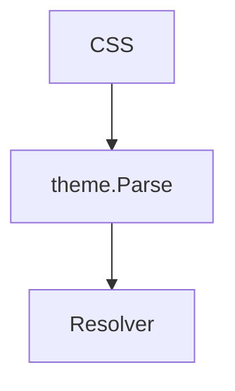

# 主题词汇表

这一篇文档覆盖了主题能匹配的每一种元素。左边的 CSS 改了什么，右边立刻能看到。

## 行内格式

正文里有 **加粗**、*斜体*、~~删除线~~、<u>下划线</u>、<mark>荧光笔</mark> 和 `行内代码`，
H<sub>2</sub>O 与 x<sup>2</sup>，还有 <kbd>Ctrl</kbd>+<kbd>K</kbd>。
行内公式 $a^2 + b^2 = c^2$ 和文字排在同一行上。

链接有 [带标题的链接](https://example.com "悬停时显示的标题")、自动链接 <https://example.com>，
以及引用式链接 [引用式][ref]。脚注在这里[^1]。转义 \* 和实体 &amp; 也各有自己的元素。

[^1]: 脚注的正文，`footnote` 与 `footnote-ref` 可以分别着色。

### 三级标题
#### 四级标题
##### 五级标题
###### 六级标题

Setext 标题
==========

## 引用

> 引用里的普通段落，里面也能有 **加粗**。
>
> > 嵌套的引用，*斜体* 照样生效。

## 列表

- 无序列表的第一项
- 第二项
  - 嵌套的项
- [x] 已完成的任务
- [ ] 未完成的任务

3. 从三开始的有序列表
4. 第二项

- 宽松的列表

- 项与项之间隔着空行

## 代码

```go
// 围栏代码块，info 是 go
func main() {
	fmt.Println("hi")
}
```

    // 缩进的代码块
    indented := true

## 公式与图表

$$
\frac{a}{b} = c
$$



## 表格

| 左对齐 | 居中 | 右对齐 |
|:-------|:----:|-------:|
| 一个   | 两个 | 三个   |
| **加粗** | `代码` | $x$ |

## 分隔线与图片

---


<div class="box">
  块级 HTML 按原文显示。
</div>

<span>行内 HTML</span> 跟在文字后面。

[ref]: https://example.com "引用式链接的定义"
